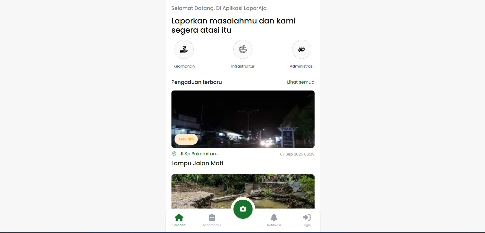
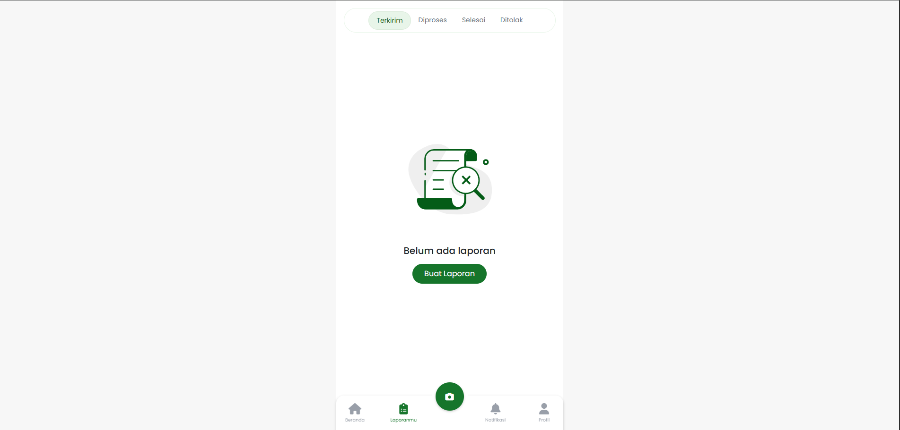
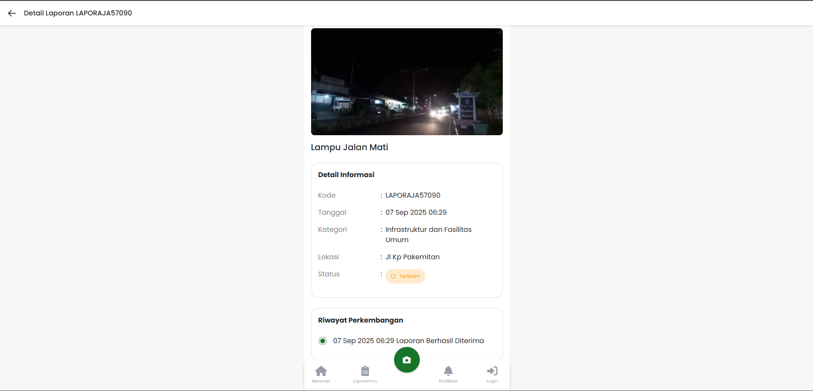

# LaporAja - Society Report Application for Rajamandala Kulon

## About The Project

**LaporAja** is a web-based application designed to facilitate the community of **Rajamandala Kulon Village** in submitting reports, complaints, or aspirations to the village administration. This project was developed as a **Final Year Thesis (Skripsi)**.

The application aims to improve transparency, efficiency, and responsiveness in handling public issues within the village, streamlining the communication between residents and village officials.

## Key Features

- **Public Reporting System:** Residents can easily submit reports regarding various issues (infrastructure, service, etc.).
- **Real-time Notifications:** Users are notified of the status of their reports.
- **Report Tracking:** Users can monitor the progress of their complaints from submission to resolution.
- **Role Management:** Distinct features for Administrators, Village Staff, and Residents.
- **Secure & Responsive:** Built with modern security practices and a responsive design for mobile and desktop.

## Screenshots

### Home Page


_The landing page of the LaporAja application, providing an overview and quick access to reporting._

### My Reports (Laporanmu)


_A dedicated page for users to track their submitted reports and view their current status._

### Report Details


_Detailed view of a specific report, including descriptions, evidence, and administrative feedback._

## Technology Stack

This application utilizes a robust and modern technology stack:

- **Backend:** [Laravel 11](https://laravel.com) (PHP 8.2+)
- **Frontend:** Blade Templates, [Tailwind CSS](https://tailwindcss.com)
- **Asset Bundling:** [Vite](https://vitejs.dev)
- **Database:** MySQL
- **Real-time Services:** Pusher
- **Additional Libraries:**
    - `spatie/laravel-permission` for role-based access control.
    - `maatwebsite/excel` for data export.
    - `realrashid/sweet-alert` for interactive user alerts.

## Getting Started

Follow these steps to set up the project locally:

1. **Clone the repository**

    ```bash
    git clone <repository_url>
    cd laporaja
    ```

2. **Install Backend Dependencies**

    ```bash
    composer install
    ```

3. **Install Frontend Dependencies**

    ```bash
    npm install
    ```

4. **Environment Configuration**
   Copy the example environment file and configure your database and third-party services (Pusher, etc.).

    ```bash
    cp .env.example .env
    php artisan key:generate
    ```

5. **Database Setup**
   Migrate the database tables and seed initial data.

    ```bash
    php artisan migrate --seed
    ```

6. **Run the Application**
   Start the development server and Vite build process.
    ```bash
    npm run dev
    # In a separate terminal
    php artisan serve
    ```

---

_Developed for Rajamandala Kulon Village Community Reporting System._
